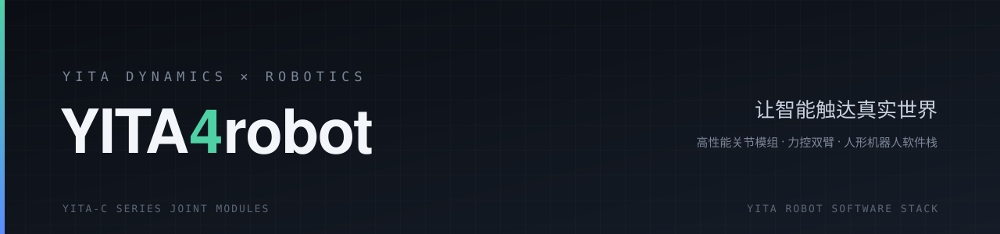

  

<h3 align="center">让智能触达真实世界</h3>

  <a href="https://www.yitadynamics.com/cn/">YITA 官网</a> &nbsp;·&nbsp;
  <a href="https://github.com/PICO4robot">PICO 软件栈</a> &nbsp;·&nbsp;
  <a href="mailto:sales@yitadynamics.com">联系我们</a>

---

**PICO4yita** 是 PICO 机器人软件栈与 YITA（伊塔动力）关节模组的工程交汇点。

YITA 提供从动力关节到力控双臂的硬件底座，PICO 提供从模型资产到整机部署的软件通路。我们让一颗关节的物理特性，直接进入仿真、训练与真机部署的同一条链路。

> 从零件精度，到系统确定性。

### 我们关注

- 关节模组驱动、标定与通信接入
- 整机模型与执行器标定
- 训练、Sim2Real 与整机部署

### 联系

[sales@yitadynamics.com](mailto:sales@yitadynamics.com) · [yitadynamics.com](https://www.yitadynamics.com/cn/)

  © 2026 PICO4yita · 文档内容 CC BY-NC 4.0

